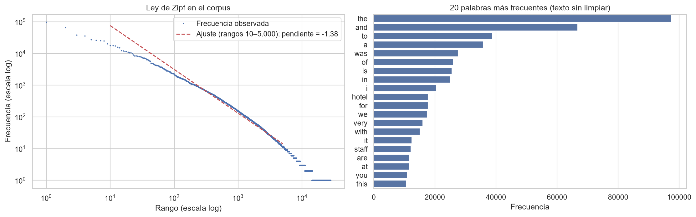
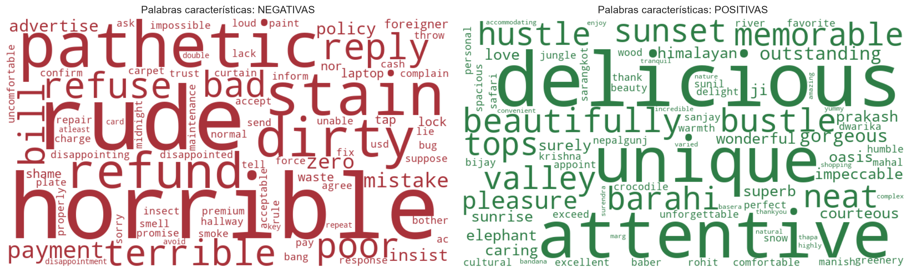

# Análisis de sentimiento y dimensiones semánticas en reseñas de hoteles de lujo

**Comparación entre representaciones dispersas (BoW / TF-IDF) y distribuidas (Word2Vec), proyecciones semánticas y modelado de tópicos**

| | |
|:--|:--|
| **Autores** | Isabel Cristina Morales Parra · Jaime Esteban Bejarano Caldas |
| **Curso** | Procesamiento de Lenguaje Natural |
| **Programa** | Maestría en Analítica Aplicada e Inteligencia Artificial · Universidad de La Sabana |
| **Profesor** | Andrés Rosso, Ph.D. |
| **Fecha** | Noviembre de 2026 |

---

## 1. Problema y objetivo

Las reseñas de huéspedes combinan una calificación numérica con un texto libre: la calificación dice *cuánto* le gustó la experiencia al huésped; el texto explica *por qué*. Este proyecto construye y evalúa un flujo de procesamiento de lenguaje natural que, a partir del texto, **predice la polaridad de la experiencia** e **identifica las dimensiones del servicio** asociadas a valoraciones positivas y negativas.

| # | Objetivo específico | Notebook | Estado |
|:--|:--|:--|:--|
| 1 | Caracterizar el corpus mediante análisis exploratorio textual | 01 | ✅ |
| 2 | Normalizar el texto y cuantificar su efecto sobre el vocabulario | 01 | ✅ |
| 3 | Comparar clasificadores con BoW, TF-IDF y Word2Vec | 02 · 03 | ✅ BoW / TF-IDF · 🔄 Word2Vec |
| 4 | Evaluar de forma intrínseca el espacio Word2Vec del dominio | 03 | 🔄 |
| 5 | Definir dimensiones del servicio mediante proyecciones semánticas | 03 | 🔄 |
| 6 | Identificar temas mediante modelado de tópicos (NMF, LDA, SVD + KMeans) | 04 | 🔄 |

---

## 2. Datos y depuración

`LuxuryHotels.csv`: 18.074 reseñas con calificación de 1 a 5 y año. La auditoría de calidad encontró tres problemas que no estaban documentados:

| Paso | Registros | Eliminados | Motivo |
|:--|--:|--:|:--|
| Archivo original | 18.074 | — | |
| Sin registros `#NAME?` | 18.071 | 3 | Error de exportación de Excel: el texto original se perdió |
| Sin duplicados | 17.976 | 95 | Textos idénticos |
| **Solo inglés** | **17.263** | 713 | Reseñas en 23 idiomas distintos del inglés (detección con `langdetect`) |


**Variable objetivo (escenario principal A):** positivo = 4–5 estrellas, negativo = 1–2 estrellas (se excluye 3). Hay **16.438 reseñas, de las cuales solo el 4,0 % son negativas** (≈ 24 : 1), por lo que la exactitud no sirve como métrica: un modelo que siempre dice «positivo» acierta el 96 %.

**Supuestos declarados:**
- La columna `YY` corresponde al año (2014–2024).
- El corpus se concentra en hoteles de Nepal (*Kathmandu*, *Pokhara*); no hay identificador de hotel.
- El origen del conjunto de datos no está documentado; se usa exclusivamente con fines académicos.

---

## 3. Exploración del corpus

**Las reseñas negativas son casi el doble de largas** (mediana de 94–100 palabras frente a 55 en las de 5 estrellas), y **la proporción de negativas cae de 7,7 % (2017) a 1,5 % (2024)**: hay deriva temporal.


El vocabulario sigue la **ley de Zipf** (pendiente −1,38) y el **48,5 % de las palabras aparece una sola vez**, en su mayoría errores de digitación y nombres propios.



**Normalización** (spaCy: lematización y eliminación de palabras vacías **conservando las negaciones**): los tokens bajan 53,1 % y el vocabulario 17,3 %.

**Vocabulario distintivo.** 10 de los 15 bigramas más característicos de las reseñas negativas contienen una negación (*not worth*, *not clean*, *not recommend*). La insatisfacción se asocia a **cobros y gestión** (*refund*, *bill*, *charge*) y a **higiene** (*dirty*, *stain*); la satisfacción, a **comida, trato y paisaje** (*delicious*, *attentive*, *valley*, *sunset*).




---

## 4. Clasificación de sentimiento

Regresión logística con `class_weight="balanced"`, `C` ajustado por validación cruzada estratificada (5 particiones), evaluada en un conjunto de prueba de 3.288 reseñas (130 negativas).

| Modelo | F1-macro | Exactitud balanceada | *Recall* negativo | Precisión negativa |
|:--|--:|--:|--:|--:|
| Línea base (siempre «positivo») | 0,490 | 0,500 | 0,000 | 0,000 |
| BoW binario | 0,884 | 0,916 | 0,846 | 0,719 |
| BoW conteos | 0,886 | 0,891 | 0,792 | 0,769 |
| **TF-IDF (uni + bigramas)** | **0,918** | **0,927** | **0,862** | **0,824** |
| Word2Vec (promedio) | 🔄 | | | |

**TF-IDF con bigramas** detecta 112 de las 130 reseñas negativas. Su ventaja proviene de la ponderación IDF y de los bigramas con negación.


La **negación** (*not*) es la señal negativa más fuerte del modelo.


---

## 5. Word2Vec y proyecciones semánticas

🔄 *En desarrollo (notebook 03).*

## 6. Modelado de tópicos

🔄 *En desarrollo (notebook 04).*

## 7. Conclusiones

🔄 *Pendiente.*

---

## Estructura del repositorio

```
├── data/
│   ├── raw/            LuxuryHotels.csv (original)
│   └── processed/      Corpus depurado y normalizado
├── notebooks/          01 datos y exploración · 02 clasificación · 03 Word2Vec · 04 tópicos · 05 evaluación
├── src/                preprocesamiento.py · evaluacion.py · representaciones.py
├── results/            Tablas y métricas (CSV)
├── figures/            Gráficos
├── references/         Artículos de referencia
├── informe/            Informe final y anteproyecto
└── presentacion/       Diapositivas
```

## Cómo ejecutar

1. Clonar: `git clone https://github.com/isabelmorales2108-ux/pln-luxuryhotels-sentimiento.git`
2. Entorno Python 3.12 con: `pandas`, `numpy`, `scikit-learn`, `gensim`, `spacy`, `nltk`, `langdetect`, `seaborn`, `wordcloud`; modelo de spaCy: `python -m spacy download en_core_web_sm`
3. Ejecutar los notebooks en orden (01 → 05). El notebook 01 genera `data/processed/`, que usan los demás.

## Referencias

- Mikolov, T., Chen, K., Corrado, G. y Dean, J. (2013). *Efficient Estimation of Word Representations in Vector Space*. arXiv:1301.3781.
- Mikolov, T., Sutskever, I., Chen, K., Corrado, G. y Dean, J. (2013). *Distributed Representations of Words and Phrases and their Compositionality*. arXiv:1310.4546.
- Blei, D., Ng, A. y Jordan, M. (2003). *Latent Dirichlet Allocation*. JMLR, 3, 993–1022.
- Lee, D. y Seung, H. (1999). *Learning the parts of objects by non-negative matrix factorization*. Nature, 401, 788–791.
