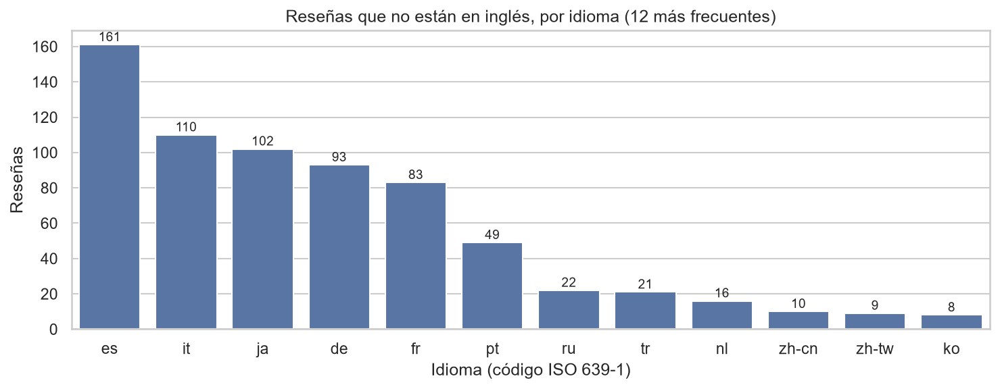
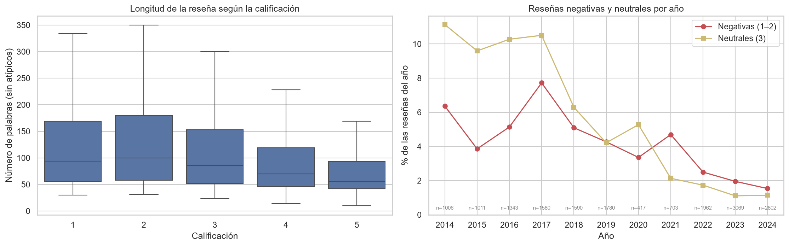
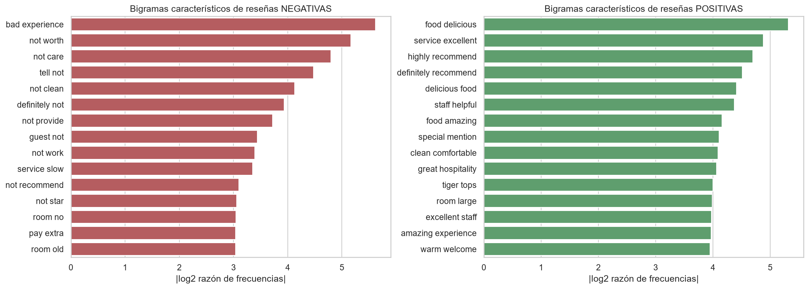
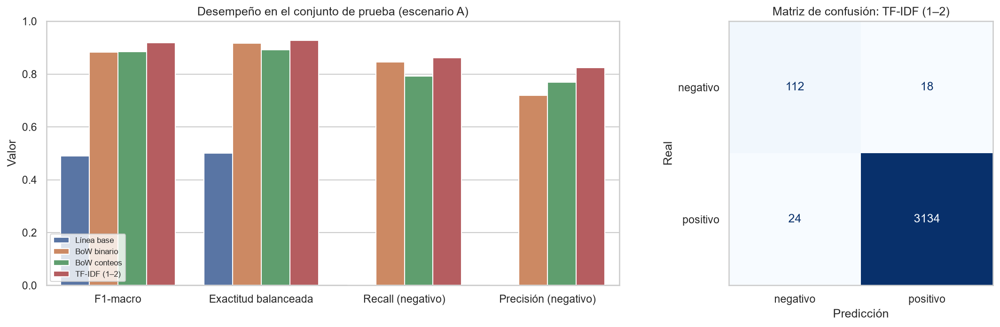
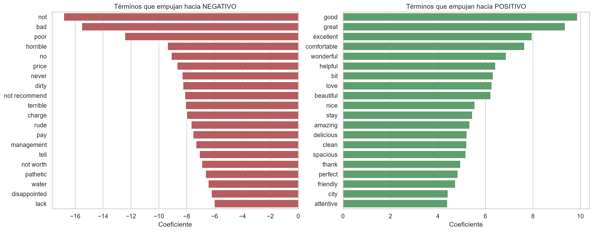
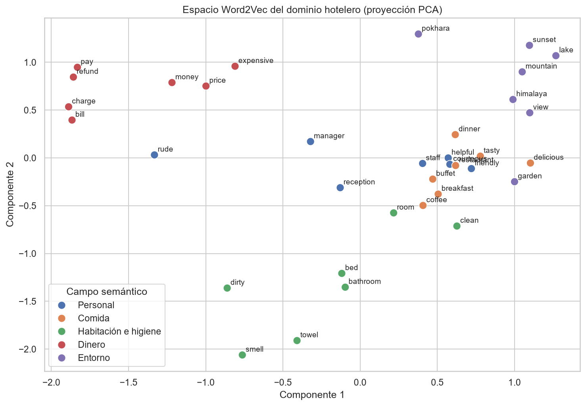
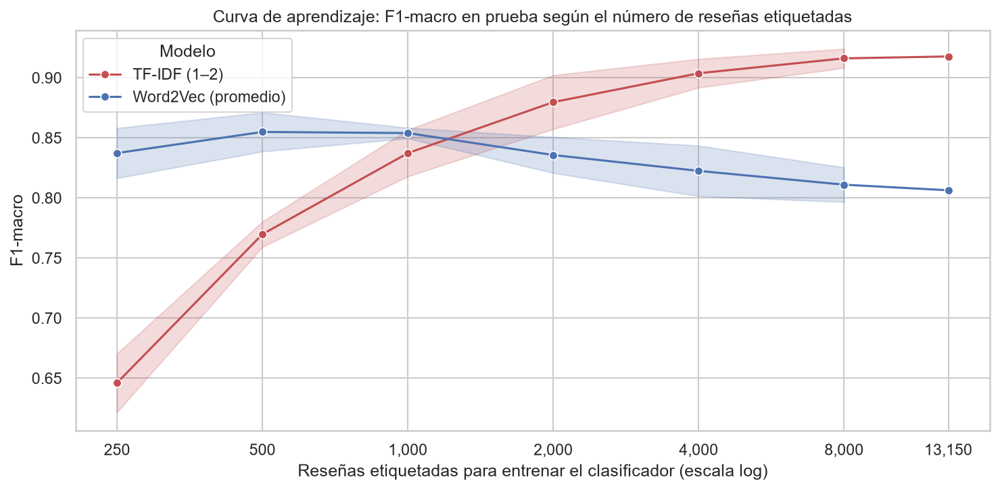
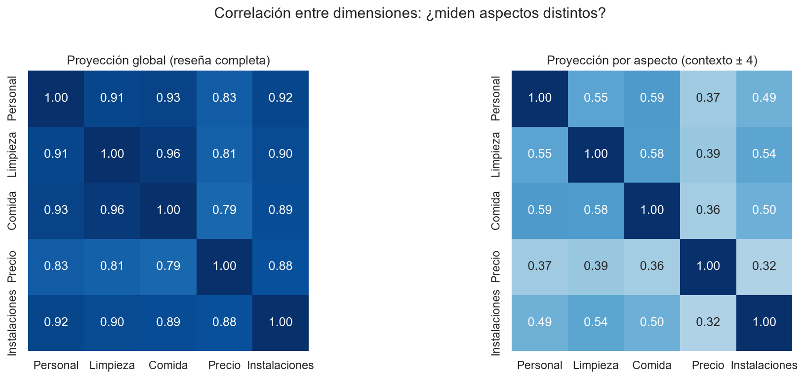
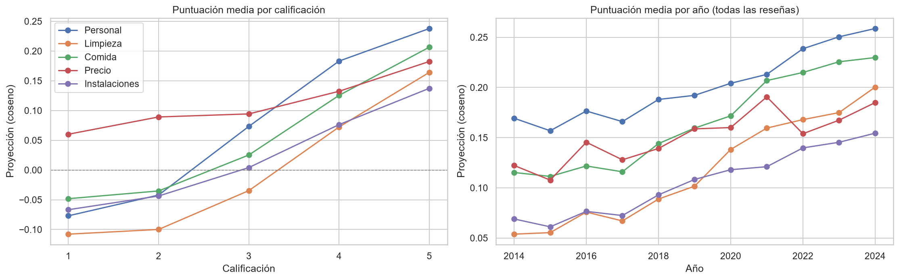
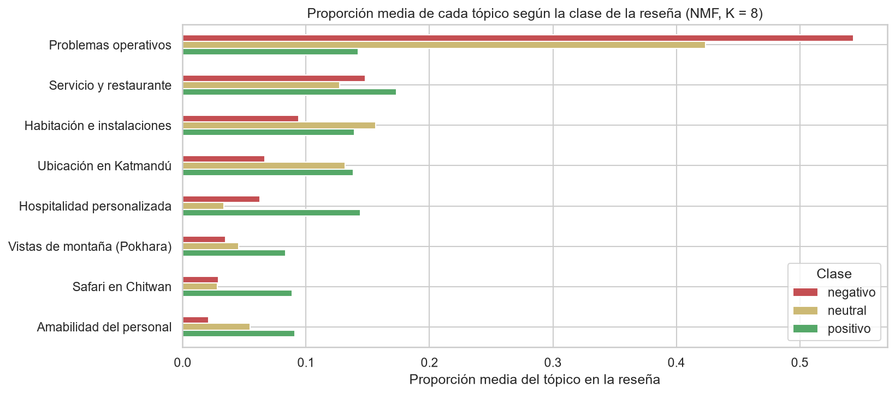

# Análisis de sentimiento y dimensiones semánticas en reseñas de hoteles de lujo

**Comparación entre representaciones dispersas (BoW / TF-IDF) y distribuidas (Word2Vec), proyecciones semánticas y modelado de tópicos**

| | |
|:--|:--|
| **Autores** | Isabel Cristina Morales Parra · Jaime Esteban Bejarano Caldas |
| **Curso** | Procesamiento de Lenguaje Natural |
| **Programa** | Maestría en Analítica Aplicada e Inteligencia Artificial · Universidad de La Sabana |
| **Profesor** | Andrés Rosso, Ph.D. |
| **Fecha** | Noviembre de 2026 |

---

## 1. Problema y objetivo

Las reseñas de huéspedes combinan una calificación numérica con un texto libre: la calificación dice *cuánto* le gustó la experiencia al huésped; el texto explica *por qué*. Este proyecto construye y evalúa un flujo de procesamiento de lenguaje natural que, a partir del texto, **predice la polaridad de la experiencia** e **identifica las dimensiones del servicio** asociadas a valoraciones positivas y negativas.

| # | Objetivo específico | Notebook | Estado |
|:--|:--|:--|:--|
| 1 | Caracterizar el corpus mediante análisis exploratorio textual | 01 | ✅ |
| 2 | Normalizar el texto y cuantificar su efecto sobre el vocabulario | 01 | ✅ |
| 3 | Comparar clasificadores con BoW, TF-IDF y Word2Vec | 02 · 03 | ✅ BoW / TF-IDF · ✅ Word2Vec |
| 4 | Evaluar de forma intrínseca el espacio Word2Vec del dominio | 03 | ✅ |
| 5 | Definir dimensiones del servicio mediante proyecciones semánticas | 03 | ✅ |
| 6 | Identificar temas mediante modelado de tópicos (NMF, LDA, SVD + KMeans) | 04 | ✅ |

---

## 2. Datos y depuración

`LuxuryHotels.csv`: 18.074 reseñas con calificación de 1 a 5 y año. La auditoría de calidad encontró tres problemas que no estaban documentados:

| Paso | Registros | Eliminados | Motivo |
|:--|--:|--:|:--|
| Archivo original | 18.074 | — | |
| Sin registros `#NAME?` | 18.071 | 3 | Error de exportación de Excel: el texto original se perdió |
| Sin duplicados | 17.976 | 95 | Textos idénticos |
| **Solo inglés** | **17.263** | 713 | Reseñas en 23 idiomas distintos del inglés (detección con `langdetect`) |



**Variable objetivo (escenario principal A):** positivo = 4–5 estrellas, negativo = 1–2 estrellas (se excluye 3). Hay **16.438 reseñas, de las cuales solo el 4,0 % son negativas** (≈ 24 : 1), por lo que la exactitud no sirve como métrica: un modelo que siempre dice «positivo» acierta el 96 %.

**Supuestos declarados:**
- La columna `YY` corresponde al año (2014–2024).
- El corpus se concentra en hoteles de Nepal (*Kathmandu*, *Pokhara*); no hay identificador de hotel.
- El origen del conjunto de datos no está documentado; se usa exclusivamente con fines académicos.

---

## 3. Exploración del corpus

**Las reseñas negativas son casi el doble de largas** (mediana de 94–100 palabras frente a 55 en las de 5 estrellas), y **la proporción de negativas cae de 7,7 % (2017) a 1,5 % (2024)**: hay deriva temporal.



El vocabulario sigue la **ley de Zipf** (pendiente −1,38) y el **48,5 % de las palabras aparece una sola vez**, en su mayoría errores de digitación y nombres propios.


**Normalización** (spaCy: lematización y eliminación de palabras vacías **conservando las negaciones**): los tokens bajan 53,1 % y el vocabulario 17,3 %.

**Vocabulario distintivo.** 10 de los 15 bigramas más característicos de las reseñas negativas contienen una negación (*not worth*, *not clean*, *not recommend*). La insatisfacción se asocia a **cobros y gestión** (*refund*, *bill*, *charge*) y a **higiene** (*dirty*, *stain*); la satisfacción, a **comida, trato y paisaje** (*delicious*, *attentive*, *valley*, *sunset*).




---

## 4. Clasificación de sentimiento

Regresión logística con `class_weight="balanced"`, `C` ajustado por validación cruzada estratificada (5 particiones), evaluada en un conjunto de prueba de 3.288 reseñas (130 negativas).

| Modelo | F1-macro | Exactitud balanceada | *Recall* negativo | Precisión negativa |
|:--|--:|--:|--:|--:|
| Línea base (siempre «positivo») | 0,490 | 0,500 | 0,000 | 0,000 |
| BoW binario | 0,884 | 0,916 | 0,846 | 0,719 |
| BoW conteos | 0,886 | 0,891 | 0,792 | 0,769 |
| **TF-IDF (uni + bigramas)** | **0,918** | **0,927** | **0,862** | **0,824** |
| Word2Vec (promedio) | 0,806 | 0,945 | **0,931** | 0,482 |

**TF-IDF con bigramas** detecta 112 de las 130 reseñas negativas. Su ventaja proviene de la ponderación IDF y de los bigramas con negación.



La **negación** (*not*) es la señal negativa más fuerte del modelo.



---
## 5. Word2Vec y proyecciones semánticas

**Espacio vectorial del dominio** (skip-gram, 100 dimensiones, entrenado solo con las reseñas de entrenamiento): *dirty* → *filthy, mould, stain*; *refund* → *cancellation, agoda, payment*; la analogía *kathmandu − city + lake* devuelve **phewa**, el lago de Pokhara. El primer componente principal separa lo negativo de lo positivo.



**Curva de aprendizaje.** Con pocas reseñas etiquetadas, **Word2Vec supera a TF-IDF** (F1-macro 0,837 frente a 0,646 con 250 reseñas); las curvas se cruzan alrededor de 1.000 y con el conjunto completo gana TF-IDF (0,918 frente a 0,806). Word2Vec aprende la semántica sin etiquetas, pero el promedio de vectores diluye la negación.



**Dimensiones del servicio.** Proyectar la reseña completa produce dimensiones redundantes (correlación 0,79–0,96: todas miden el sentimiento general); proyectar solo el contexto de cada aspecto las separa (0,32–0,59).



| Dimensión | Mencionada en negativas | d de Cohen | Hallazgo |
|:--|--:|--:|:--|
| Personal | 71 % | **2,72** | La que más separa experiencias positivas y negativas |
| Limpieza | 70 % | 2,03 | La peor valorada en las negativas; sobrerrepresentada |
| Comida | 57 % | 2,22 | |
| Precio | 40 % | 0,93 | 3,6 veces más frecuente en negativas; quejas de cobros, no de precio alto |
| Instalaciones | 43 % | 1,82 | |



## 6. Modelado de tópicos

Se compararon **NMF + TF-IDF**, **LDA + conteos** y **SVD + KMeans** (línea base) con K = 8 y K = 12, sobre el mismo vocabulario (4.088 términos).

| Método | K | NPMI ↑ | Diversidad@10 ↑ | Estabilidad Jaccard ↑ | NMI externo | Tiempo (s) ↓ |
|:--|--:|--:|--:|--:|--:|--:|
| **NMF + TF-IDF** | **8** | **0,160** | **0,888** | **0,955** | 0,066 | 5 |
| NMF + TF-IDF | 12 | 0,163 | 0,892 | 0,576 | 0,059 | 3 |
| LDA + conteos | 8 | 0,120 | 0,662 | 0,586 | 0,095 | 209 |
| LDA + conteos | 12 | 0,134 | 0,600 | 0,432 | 0,113 | 205 |
| SVD + KMeans | 8 | 0,141 | 0,625 | 0,648 | 0,092 | 3 |
| SVD + KMeans | 12 | 0,126 | 0,517 | 0,695 | 0,078 | 3 |

**Selección: NMF con K = 8**, el mejor en coherencia, diversidad y estabilidad. Con K = 12 la estabilidad cae a 0,576: los tópicos adicionales dependen de la semilla.

**Sin usar las calificaciones, el modelo aisló el tema de la insatisfacción:** el tópico *Problemas operativos* (*room, night, check, water, work*) ocupa el **54 % de las reseñas negativas y el 14 % de las positivas**. Los tópicos de destino (*Safari en Chitwan*, *Vistas de Pokhara*) y de trato (*Amabilidad del personal*) predominan en las positivas.



**Validación humana.** En la prueba de intrusión de palabras, el evaluador identificó la intrusa en 2 de 8 tópicos (25 %, frente a 16,7 % por azar). Los aciertos ocurrieron en los tópicos de menor NPMI: la coherencia estadística y la interpretabilidad humana no coinciden en este dominio homogéneo.


## 7. Evaluación final y análisis de errores

| Validación | F1-macro | *Recall* negativo | Precisión negativa |
|:--|--:|--:|--:|
| Aleatoria estratificada (80/20) | 0,918 | 0,862 | 0,824 |
| **Temporal** (2014–2021 → 2022–2024) | **0,921** | **0,868** | **0,825** |

**La deriva temporal no degrada el modelo**: el vocabulario de la insatisfacción es estable en el tiempo.

**Análisis de errores.** Los errores se concentran en calificaciones intermedias (2 y 4 estrellas) y en reseñas largas (mediana de 90 palabras frente a 58). Los falsos negativos son quejas graves rodeadas de elogios; los **falsos positivos más confiados son reseñas de queja con 4 estrellas** (piscina fuera de servicio, cobros ocultos, sin agua caliente). Ahí el modelo lee el texto mejor de lo que la calificación lo resume.

**Uso del modelo:**
```python
from src.prediccion import predict_sentiment
predict_sentiment("The room was not clean and they charged us extra.")
# {'clase': 'negativo', 'probabilidad_negativo': 0.993, ...}
```

## 8. Conclusiones

**Qué se logró**
1. Un corpus depurado y trazable: la auditoría encontró errores de exportación (`#NAME?`) y un 4 % de reseñas en 23 idiomas, no documentados en el conjunto de datos.
2. Un clasificador de sentimiento con **F1-macro de 0,92** (TF-IDF + bigramas), robusto a la deriva temporal, frente a 0,49 de la línea base.
3. Evidencia de que **la representación conveniente depende de cuántos datos etiquetados haya**: Word2Vec gana con menos de ~1.000 reseñas; TF-IDF con más.
4. Dimensiones del servicio medibles: el **personal** es lo que más separa las experiencias; la **limpieza**, lo peor valorado en las negativas; el **precio**, lo más específico de la insatisfacción (quejas de cobros).
5. Un tema de insatisfacción (*Problemas operativos*) descubierto **sin etiquetas** por NMF, que ocupa el 54 % de las reseñas negativas.

**Qué no fue posible**
- Analizar por hotel o ciudad, porque el conjunto de datos no tiene identificador.
- Aprovechar las 713 reseñas en otros idiomas.
- Captar el contraste dentro de una reseña («*great food, but rude staff*»): la bolsa de palabras y el promedio de vectores suman señales sin entender cuál pesa más.
- Una validación humana robusta de los tópicos: un solo evaluador y 8 ítems.

**Aprendizajes**
- **Conservar las negaciones** fue la decisión de preprocesamiento más importante: *not* es la señal negativa más fuerte del modelo.
- **La exactitud engaña** con clases desbalanceadas; el F1-macro y el *recall* de la clase minoritaria son las métricas adecuadas.
- **Una proyección semántica de la reseña completa mide el sentimiento general**, no el aspecto: hay que delimitar el contexto que se proyecta.
- **La calificación no es una etiqueta perfecta**: los errores del modelo revelan quejas escondidas tras buenas calificaciones.

**Trabajo futuro:** análisis de sentimiento por aspecto, modelos contextuales (*transformers*) y *embeddings* multilingües.

---

## Estructura del repositorio

```
├── data/
│   ├── raw/            LuxuryHotels.csv (original)
│   └── processed/      Corpus depurado y normalizado
├── notebooks/          01 datos y exploración · 02 clasificación · 03 Word2Vec · 04 tópicos · 05 evaluación
├── src/                preprocesamiento.py · evaluacion.py · representaciones.py · proyecciones.py · topicos.py · prediccion.py
├── results/            Tablas y métricas (CSV)
├── figures/            Gráficos
├── references/         Artículos de referencia
├── informe/            Informe final y anteproyecto
└── presentacion/       Diapositivas
```

## Cómo ejecutar

1. Clonar: `git clone https://github.com/isabelmorales2108-ux/pln-luxuryhotels-sentimiento.git`
2. Crear el entorno: `conda env create -f environment.yml` y activarlo con `conda activate nlp312`.
3. Ejecutar los notebooks en orden (01 → 05). El notebook 01 genera `data/processed/`, que usan los demás.

## Referencias

- Mikolov, T., Chen, K., Corrado, G. y Dean, J. (2013). *Efficient Estimation of Word Representations in Vector Space*. arXiv:1301.3781.
- Mikolov, T., Sutskever, I., Chen, K., Corrado, G. y Dean, J. (2013). *Distributed Representations of Words and Phrases and their Compositionality*. arXiv:1310.4546.
- Blei, D., Ng, A. y Jordan, M. (2003). *Latent Dirichlet Allocation*. JMLR, 3, 993–1022.
- Lee, D. y Seung, H. (1999). *Learning the parts of objects by non-negative matrix factorization*. Nature, 401, 788–791.
